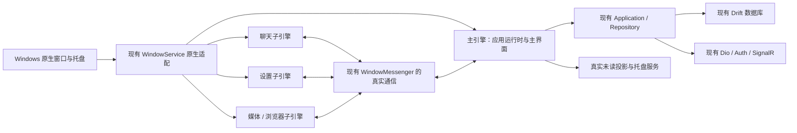
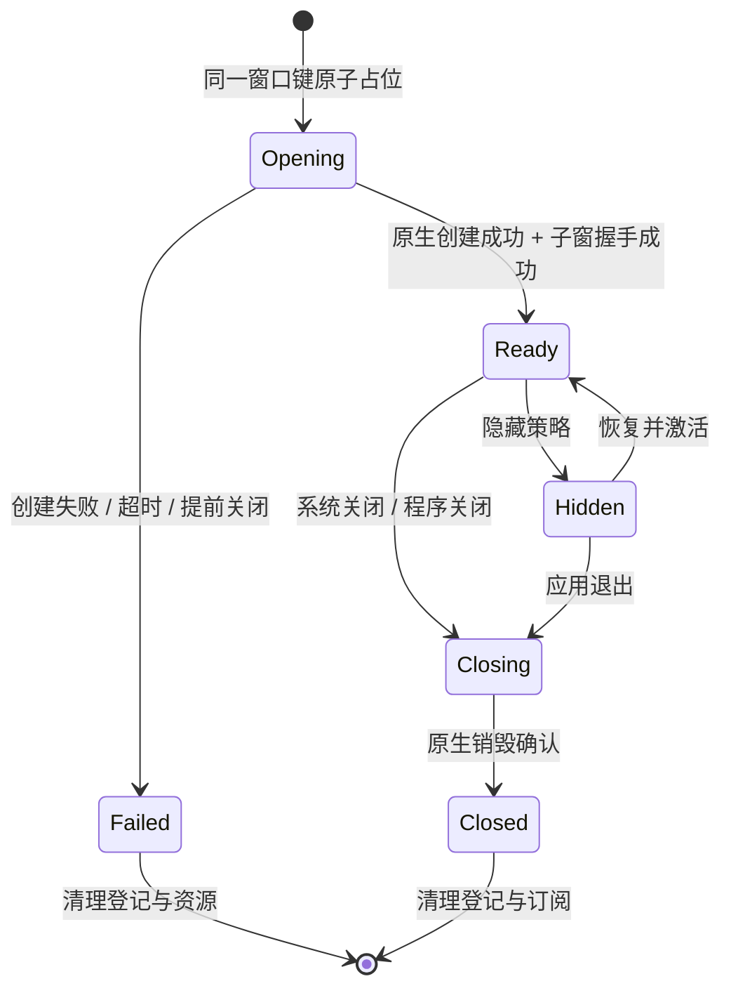

# GotoIM Flutter 桌面端原生多窗口改进方案

日期：2026-10-17  
状态：设计与实施建议，尚未执行业务代码改造  
范围：Windows 优先，保留 macOS 适配边界；移动端与 Web 继续使用现有页面导航

## 1. 建议先做什么

桌面端接近微信，首先要让聊天、设置、网页、媒体成为真正可独立操作的系统窗口，然后统一外观与交互。当前最值得优先投入的是原生窗口宿主、窗口生命周期、跨窗口业务状态同步和身份隔离。

建议沿用现有 `WindowService` 与 `WindowMessenger`，补齐原生实现。以 `desktop_multi_window` 的多引擎方案作为首个验证候选，在当前 Flutter SDK 上通过真实插件、发布包和托盘测试后再正式引入。窗口尺寸、焦点和标题栏控制按验证结果选择兼容版本的窗口管理插件，或在现有 runner 中补充有限的原生桥接。

认证、Token 刷新、SignalR、业务 Repository、本地数据库写入和托盘由主引擎统一持有；子窗口使用轻量启动入口，通过既有通信抽象获取视图数据和提交操作。主窗口隐藏后主引擎继续运行。

**第一批可交付成果：主窗口 + 一个真实聊天窗口 + 一个真实设置窗口，同时可用、关闭可重开、重复打开只激活、切换身份不串数据。** 浏览器、媒体和托盘浮窗随后按同一窗口体系接入。

## 2. 依据与适用边界

本方案基于本地代码核对及本次真实账号 Windows 运行记录：

- [完整实机测试报告](../screenshots/windows-live-20261017/README.md)
- [53 张截图索引](../screenshots/windows-live-20261017/index.html)
- [原生窗口 ID 核对记录](../screenshots/windows-live-20261017/native-window-audit.json)

测试时打开聊天、设置、浏览器和媒体，原生窗口 ID 均未增加。本次运行复用已有真实登录态；没有发送真实消息或创建真实群组。原生托盘图标及右键菜单尚未完成截图验收，不能按已验证通过处理。

测试与代码核对期间存在其他任务并行修改源码。下面明确区分“已观察的问题”“代码结构风险”和“拟实现的目标”；上线前应以冻结的源码提交和安装包重新验收。本方案未实测微信各版本，不声称复刻某一微信版本的全部细节；下述尺寸与交互为 GotoIM 建议规范。

## 3. 当前差距与优先级

| 优先级 | 当前事实或风险 | 用户影响 | 改进方向 |
| --- | --- | --- | --- |
| P0 | `openChat()` 使用聊天路由；设置、浏览器、媒体使用 `showDialog()` | 无法移到另一显示器，无法独立最小化或切换 | 创建独立顶层原生窗口，承载现有业务内容 |
| P0 | `bringToFront()`、跨窗口发送主要为日志占位 | 重复打开、托盘恢复主窗口等行为不完整 | 接入真实控制器与通信，并验证 OS 结果 |
| P0 | 设置关闭后注册表仍保留，本次已复现无法重开 | 常用工具一次打开后失效 | 原生关闭事件清理注册与订阅，创建失败回滚 |
| P0 | 切换身份后分栏仍显示旧身份聊天，本次已复现 | 展示上下文与当前身份不一致 | 主窗选择状态重置；独立聊天固定身份；命令校验作用域 |
| P0 | Windows 视频初始化报 `UnimplementedError` | 真实视频持续转圈 | 核对 Windows 播放后端，明确错误与重试；纳入多引擎验证 |
| P1 | 600/450 宽度下聊天输入区与工具区溢出 | 窄窗不可正常操作 | 主窗响应式布局，独立聊天采用专门布局 |
| P1 | 托盘列表初始化为示例数据，浮窗仍在主 Flutter 页面内 | 未读提示与真实账号不一致，主窗隐藏时体验不成立 | 真实未读投影 + 独立原生浮窗 |
| P1 | `supportsMultipleWindows` 主要依据平台判断 | “平台支持”被当作“实现就绪” | 加入运行能力探测和明确失败状态 |
| P1 | `WindowMessenger` 注释将共享 SQLite WAL 等同于 Stream 自动同步 | 多引擎改造后可能出现旧数据 | 主引擎数据源 + IPC 同步，纠正该假设 |
| P1 | 测试启动需临时 PATH 才找到 `sqlite3.dll` | 开发机可用不代表安装包可用 | 干净环境验证 native assets、插件 DLL 与运行库 |

截图对照：[当前聊天“独立窗口”](../screenshots/windows-live-20261017/05-open-chat-window-actually-same-window-route.png)、[设置无法重开](../screenshots/windows-live-20261017/17-settings-reopen-fails.png)、[窄窗溢出](../screenshots/windows-live-20261017/09-chat-450x700-severe-overflow.png)、[身份切换残留](../screenshots/windows-live-20261017/44-owner-switched-old-chat-remains.png)、[示例托盘](../screenshots/windows-live-20261017/29-tray-flyout-live-ui-with-demo-data.png)、[真实视频失败](../screenshots/windows-live-20261017/53-real-video-preview-stuck-loading.png)。

## 4. “真正的新窗口”的验收定义

聊天、设置、浏览器、媒体必须具有自己的顶层 HWND。插件窗口 ID、Flutter View ID、HWND 分别记录，不能混为一谈。一个进程可以包含多个真正的窗口，无须为每个窗口另起应用进程。

普通独立窗口应能拖离主窗口边界、放到第二显示器，独立缩放、最小化、恢复、关闭；主窗口内容不出现遮罩，也不因子窗口打开而禁止操作。聊天、浏览器、媒体按产品策略参与 Alt+Tab 和任务栏分组，Windows 允许将多个窗口归入同一个应用按钮，不要求每窗单独占一个应用按钮。

托盘浮窗属于特殊窗口：独立原生承载、默认不进入任务栏和 Alt+Tab、不因被动消息抢走输入焦点；用户点击时才执行对应操作。删除确认、重命名等局部操作可以继续使用所属窗口内的对话框。

验收必须同时提供系统窗口枚举记录、可见操作结果和真实屏幕截图。仅凭 Widget 名称中带 `Window`、新增注册表记录或画出标题栏，不能证明实现了原生多窗口。

## 5. 技术路线选择

### 5.1 现有依赖能提供什么

项目已有 `tray_manager 0.8.0`、传递依赖 `cnativeapi 0.5.2`，尚未直接引入 `desktop_multi_window` 或 `window_manager`。现有 `cnativeapi` 是底层 FFI 绑定，不能仅因存在创建 native window 的 API 就认为它能够直接承载第二个 Flutter 页面；还需要 Flutter View/engine 的宿主和生命周期管理。本地包 README 也将它定位为底层绑定。

### 5.2 候选比较与建议

| 路线 | 优点 | 需要验证的代价 | 本项目建议 |
| --- | --- | --- | --- |
| `desktop_multi_window` 多引擎 | 已提供创建窗口、窗口发现和通信机制 | 每窗独立引擎与 Dart 状态；插件多引擎兼容；内存开销 | 首个 POC 候选，通过门槛后采用 |
| Flutter 自带实验窗口 API，配合 nativeapi 桥接 | 有望单引擎多窗口，减少跨引擎状态复制 | 当前本地 SDK 明确标记 internal/experimental，补丁版本也可能破坏兼容 | 保留研究样例，不作为本轮生产基线 |
| 自行在 C++/Swift runner 管理多个引擎与窗口 | 生命周期和系统行为可控 | 自行维护宿主、插件注册、通信和跨平台差异 | 候选插件存在不可接受阻塞时再评估 |
| 保留 `showDialog` 或应用内浮层 | 改造量小 | 不满足独立系统窗口目标 | 仅用于局部确认、菜单等场景 |

截至本次核查，`desktop_multi_window` 的维护者文档列出 `WindowController`、`WindowConfiguration`、`WindowMethodChannel`，并说明每窗有独立引擎、子引擎需要注册插件。现有 `WindowMessenger` 中旧式 `DesktopMultiWindow.invokeMethod` 注释不能直接照搬为新版本实现。参见[维护者说明](https://pub.dev/packages/desktop_multi_window)。

`window_manager` 用于窗口属性和行为控制，不能单独代替创建多 Flutter 窗口的宿主。其页面已有迁移提示；多窗口插件文档也列出了特定兼容 fork。应核对稳定版修复情况与组合实测结果，锁定版本或确切提交，不能直接跟随浮动分支。参见[窗口管理插件说明](https://pub.dev/packages/window_manager)。

本地 Flutter 3.47.0 的 `packages/flutter/lib/src/widgets/_window.dart` 明确要求生产代码不要使用该内部接口；这与[Flutter 官方源码](https://github.com/flutter/flutter/blob/stable/packages/flutter/lib/src/widgets/_window.dart)中的实验标记一致。当前 [nativeapi 示例](https://pub.dev/packages/nativeapi)仍通过内部窗口 API 承载额外 Flutter 窗口。**不建议为了本次需求直接切换 Flutter channel、升级 SDK 或开启内部实验开关。**

上述为有依据的候选选择，尚未在本项目验证所述插件组合。POC 未通过前不承诺可发布。

### 5.3 进入正式改造前的 POC 门槛

1. 使用当前 SDK 创建两个真实顶层窗口，首次显示没有白屏、闪现或错误焦点。
2. 主窗和子窗分别运行图片、输入法、剪贴板、文件选择、WebView、视频；每项检查必要插件是否支持多引擎，禁止只验证空白示例页。
3. 主窗隐藏后子窗继续工作，托盘可恢复主窗；子窗关闭不会退出整个进程。
4. 连续开关设置 20 次、打开 5 个聊天窗口，记录 HWND、引擎数、订阅数及内存变化，确认无持续泄漏。
5. 在无开发 PATH 的 Windows Release 安装包中复现以上结果。
6. 输出实际依赖版本、native 修改、失败项与取舍；遇到插件内部单例冲突时，先评估有限修补，再决定是否改用自建宿主。

## 6. 窗口类型与微信式交互规范

以下尺寸均为建议的逻辑像素，不是微信测量值；原生 API 使用物理坐标时必须按所在显示器 DPI 转换。初始尺寸不能超过当前显示器可用工作区。

| 窗口 | 建议初始 / 最小尺寸 | 实例与身份 | 关闭及系统行为 |
| --- | --- | --- | --- |
| 主窗口 | 1180×780 / 720×560 | 单实例，允许切换聊天身份 | 默认关闭隐藏到托盘；明确“退出”才结束应用 |
| 独立聊天 | 760×680 / 420×420 | 账号+身份+SessionUnit 唯一；身份固定 | 关闭销毁；重复入口恢复并激活；可跨屏 |
| 设置 | 800×620 / 640×480 | 每账号一个，账号变化关闭 | 关闭销毁；非模态，不阻挡主窗；不必置顶 |
| 浏览器 | 1100×760 / 640×480 | 第一阶段每账号一个窗口，支持页签 | 置顶为可选真实属性；关闭窗口释放 WebView |
| 媒体预览 | 1000×760 / 480×360 | 每账号一个，切换当前媒体上下文 | 支持全屏、Esc 退出全屏/关闭、键盘切换 |
| 托盘未读浮窗 | 宽 360～420，高度受工作区约束 | 应用级单实例，数据按账号/身份分组 | 不进任务栏；失焦/外部点击收起；空数据有空态 |
| 文件与诊断工具 | 960×700 / 640×480 | 按工具用途复用 | 文件任务属于应用；关窗不默认取消传输 |

主窗口布局建议以可用内容宽度分档：约 1000 以上使用导航轨、会话列表、聊天三栏；720～999 压缩会话栏并提供折叠；低于约 720 时切换“列表/会话”单内容模式。即使产品最终限制最小宽度，Widget 仍应处理小工作区、系统缩放和自动化测试的受限尺寸。

独立聊天只保留会话标题、消息区与输入区，不复制主窗 Dock、身份切换栏和会话列表。工具按钮按空间折叠进“更多”，输入区设置合理上下界，保证输入法候选、附件条与发送按钮可见。

统一桌面窗口外观：轻量标题栏、清晰的拖动区域、统一关闭/最大化/最小化命中区，沿用现有颜色、排版和主题 tokens。系统按钮操作实际窗口，置顶操作实际 topmost 状态，最大化按钮读真实窗口状态，避免仅切换本地布尔变量。Windows 11 Snap、双击标题栏、边缘缩放、键盘访问和屏幕阅读器需要专项验证；仅画出按钮不算支持这些行为。

窗口位置按类型保存，并校正到当前显示器工作区；拔掉外接屏后不能恢复到屏幕外。第一版只恢复尺寸与位置，不自动恢复全部私密聊天窗口。

## 7. 应用与子窗口职责



“主引擎”表示应用级运行时，不等于主窗口必须一直可见。继续复用现有 Riverpod、Repository 和客户端链路，不新建第二套登录、聊天缓存或网络框架。

| 主引擎统一拥有 | 子窗口拥有 |
| --- | --- |
| 登录状态、设备上下文、Token 与刷新协调 | 固定窗口身份、展示数据快照 |
| SignalR 连接、重连和增量同步 | 自身滚动、选择、搜索、输入焦点 |
| 现有消息发送、撤回、已读业务流程 | 草稿编辑态，按约定持久化 |
| Repository、本地库写入及迁移入口 | 窗口订阅与局部 UI 状态 |
| 未读聚合、通知、传输队列、退出流程 | 自身 WebView 或媒体控制器及释放 |
| WindowService 注册表和窗口授权映射 | IPC 客户端和必要平台插件 |

`main()` 在完整业务 bootstrap 之前区分主窗口和子窗口。主窗口运行现有 `bootstrap()`；子窗口进入轻量 bootstrap，只初始化绑定、窗口控制、主题、语言、必要插件以及通过 IPC 代理的业务依赖。禁止每个子窗口完整运行原 bootstrap，重复注册设备、创建 SignalR、迁移数据库或处理全局深链。

现有 `miniAppMain()` 是 MiniApp 的独立入口，不能直接假定等同 Windows 子窗入口。仅借鉴其轻量初始化思路，按最终选定宿主的参数协议完成入口分流。

现有聊天/设置 Widget 直接依赖部分 auth、session 和数据 Provider。迁移时须逐项列出依赖，通过现有 Repository 合约的代理实现或明确的只读状态覆盖满足它们，不能把整个主 `ProviderContainer` 当作可跨引擎共享对象。UI 不直接引用多窗口插件。

## 8. 窗口标识与生命周期

窗口键必须具有业务作用域，例如：

```text
main
chat:{accountScope}:{ownerId}:{sessionUnitId}
settings:{accountScope}
browser:{accountScope}
media:{accountScope}
tray:unread
```

`accountScope` 应关联认证服务器/租户/账号，防止不同环境相同用户 ID 冲突。显示名称不参与唯一性。当前 `chat:$sessionUnitId` 缺少身份边界；`ownerId` 不应缺省为 0 后继续开启可发送窗口，缺失时从可信上下文解析并校验，无法确认则明确失败。

在现有 `WindowRecord` 中补充所需原生标识、状态、身份及最后可用时间。插件 ID 可能与当前 `int? windowId` 类型不同，应以实测 API 为准并完成边界转换；不把 HWND 强转为插件 ID，也不依赖子窗 ID 为 0 或连续编号。



打开流程：检查就绪窗口并恢复激活；正在创建则等待同一个 Future，阻止双击/并发入口创建重复窗口；首次创建先隐藏，子窗完成 IPC 注册并获取必要首屏状态后再显示。创建失败和握手超时必须回滚，返回可见错误，允许再次打开。

关闭流程必须同时处理右上角 X、Alt+F4、程序调用、异常引擎销毁等来源。收到 native 销毁确认才移除有效窗口映射，并释放订阅、媒体/WebView 和 pending 请求。迟到关闭回调要核对窗口实例标识，不能误删刚重开的同键窗口。启动和必要时的窗口枚举用于清理孤儿记录。

`bringToFront()` 应执行 show、最小化还原和激活，并遵循 Windows 前台焦点限制；被系统拒绝时给任务栏提示，不通过循环抢焦点解决。主窗口需明确注册，托盘调用 `bringToFront('main')` 才有真实对象。

## 9. 数据同步与命令协议

### 9.1 通信在现有抽象内实现

保留 `on/off/broadcast/sendToWindow/sendToMain` 的业务意图，底层接入锁定版本的原生通信。订阅应按窗口作用域分发，普通消息变更不无差别广播全部私密内容。子窗关闭即解除订阅。

建议消息信封至少包括：协议版本、请求 ID、窗口实例 ID、账号作用域、账号会话代次 `accountEpoch`、ownerId、sessionUnitId、方法/事件名、版本号及最小业务载荷。主引擎根据原生发送来源和已登记窗口授权检查权限，不能只相信载荷自报的 ownerId。

命令应使用白名单和类型化参数，拒绝未知方法、任意 SQL、任意文件路径读取和通用 HTTP 转发。已有应用层权限和后端校验继续生效。Token 不进入启动参数、窗口标题、IPC 日志或 WebView JavaScript 上下文；IPC 日志只记录事件类型、耗时、请求 ID 与脱敏作用域。

### 9.2 首屏快照、增量与断线恢复

1. 子窗口握手后订阅指定作用域；主引擎提供有边界的初始消息页、会话信息及同步版本。
2. 首屏快照与订阅必须消除竞态：先登记订阅并缓冲增量，取得快照水位后仅应用更新的增量；或提供具备同等一致性的握手事务。
3. 每作用域维护单调版本或等价水位；子窗丢弃重复/过期事件，发现缺口时重新获取有界快照，不能静默跳过。
4. 主引擎先通过现有业务流程写本地数据库，再通知相关窗口；历史页继续使用消息 ID 游标。
5. 大图片、视频和整段聊天历史不经 IPC 广播；传递资源引用和必要元数据，下载与文件授权走现有服务。
6. 高速消息按窗口与会话合并通知，控制队列长度；后台/隐藏窗口可降低刷新频率，恢复后按水位补齐。

### 9.3 发送与已读不能复制业务链

子窗提交发送意图，由主引擎复用现有消息发送流程。保留客户端消息标识和服务端幂等规则，同一个发送操作重试复用同一 operationId；IPC 超时表示结果未知，查询主引擎状态后再决定重试，不能自动生成第二条消息。

发送状态、撤回、编辑、已读和未读数由现有 Repository/应用层统一计算后投影到各窗。只有窗口处于前台且对应消息确实可见时才提交阅读意图，不能“窗口存在就全量已读”。主窗与子窗的草稿同步需版本控制，避免两个输入框覆盖；第一版允许各窗独立编辑，持久化键包含账号、身份和会话，并明确恢复优先级。

### 9.4 纠正共享数据库的假设

多个独立 Drift 实例即使打开同一 WAL 文件，也不会自动同步 Stream 查询。该点由 [Drift 官方 isolates 文档](https://drift.simonbinder.eu/isolates/)明确说明。

本轮优先采用主引擎持有现有数据库和 Repository，子窗通过 IPC 查询和订阅数据。这样无需增加第二套本地库初始化或迁移入口。未来如需共享 Drift isolate，必须另行验证跨 Flutter engine 的连接传递、查询更新通知与退出顺序；普通 Dart isolate 示例不能直接视作已证明跨 engine 可用。

## 10. 账号与聊天身份隔离

建议区分两种行为：

- **同一登录账号切换聊天身份**：主窗清空旧会话选择与旧聊天绑定，加载新身份列表。已经打开的独立聊天窗口继续固定在原 owner，并在标题栏显著显示该身份；不随主窗悄悄切换发送身份。原身份失去权限时窗口转为不可操作并关闭或显示失效状态。
- **切换登录账号、登出或凭据失效**：先增加 `accountEpoch` 并阻止旧窗提交命令，再取消订阅、清空敏感展示和关闭相关子窗；旧 epoch 的迟到响应全部丢弃，不能应用到新账号。超时未响应的子窗由 native 层强制销毁，完成后才进入新账号界面。

主引擎每次处理命令时校验账号、epoch、owner、SessionUnit 的对应关系。窗口仍显示旧身份并不构成继续授权的依据。不能仅广播 `ownerSwitched` 后假设所有页面已切换成功。

本次观察到了旧身份聊天残留，但没有发送消息，因此目前只能确定展示状态存在问题，不能断言已发生跨身份错误发送。新测试必须覆盖两个身份同名会话、窗口重开、切换中的延迟响应和权限失效。

## 11. 托盘与应用退出

继续复用 `TrayService`、`tray_grouped_unread_provider.dart` 和现有模型，将初始化示例列表替换为真实 Repository 的未读投影。按可访问身份聚合；角标、Tooltip、菜单与浮窗使用同一份状态。清除未读必须走现有已读业务，不能只从浮窗本地删一行。

`DesktopTrayMessageBox` 抽出可嵌入任意宿主的内容，放入独立工具型原生窗口。主窗口隐藏后仍能打开，位置依据实际托盘图标矩形与当前显示器工作区计算；拿不到图标位置时回退至可用工作区角落。验证任务栏自动隐藏、不同停靠位置和混合 DPI，避免假定主窗右下角等于系统托盘位置。

建议交互：托盘点击无未读时恢复主窗；有未读时显示浮窗；双击恢复主窗；右键显示原生菜单。具体单/双击优先级在 POC 中验证，避免一次双击触发两个冲突动作。被动更新不自动抢焦点；点击某会话后用明确 owner/session 键打开或激活聊天窗。

区分“关主窗口”“关子窗口”“退出应用”。现有 Windows runner 的 `SetQuitOnClose(true)` 需要与隐藏到托盘策略协调；插件窗口是否触发进程退出也必须实测。现有托盘 `exit(0)` 应改为统一退出协调：停止新操作、处理草稿与进行中的任务、释放子窗和订阅、断开 SignalR、关闭数据库、移除托盘，最后结束应用，设置有界超时并记录失败原因。

托盘初始化失败时主窗关闭应采用可见的替代行为，避免应用隐藏后没有恢复入口。Windows Explorer 重启后的托盘恢复也纳入验证。通知区行为参见 [Microsoft 官方说明](https://learn.microsoft.com/en-us/windows/win32/shell/notification-area)。

## 12. 浏览器、媒体与平台插件

浏览器第一阶段采用一个真实原生窗口承载多个网页页签，避免每个 URL 新建引擎。保留既有 WebView、导航和错误页能力；受保护页面的认证交互继续经过既有授权方案，避免向网页注入原生 Token。关闭页签释放对应 WebView，关闭窗口释放所有页签。新闻网页连接中止是已记录的运行结果，尚未确定根因，不能承诺仅改窗口宿主就能修复。

媒体窗口保留现有旋转、缩放、缩略图和键盘导航内容，替换外层 Dialog 宿主。视频先确认 Windows 平台实现、格式/编解码能力和多引擎纹理生命周期，再决定是否引入替代后端。通过现有 MediaService 边界接入，避免为一个失败样例直接全平台迁移播放器。加载需超时、错误原因、重试及经现有服务外部打开的出口，不能无限转圈。

| 能力 | 主/子引擎核查点 |
| --- | --- |
| 插件注册 | native 创建回调注册必要插件；检查是否存在进程级单例和重复监听 |
| WebView | WebView2 Runtime、用户数据目录、窗口销毁、弹出页策略、焦点与输入法 |
| 视频 | Windows 平台实现、播放器实例隔离、纹理释放、窗口隐藏/关闭行为 |
| 剪贴板与文件选择 | 当前窗口句柄、文件对话框归属、复制图片/文件、取消后的焦点恢复 |
| 深链与通知 | 统一由主引擎处理并分发，不在每个子引擎重复注册业务监听 |
| 托盘 | 只初始化一次；子窗注册插件不等于再次初始化托盘服务 |
| Native assets | `sqlite3.dll`、`cnativeapi` 及实际插件产物完整打包；不依赖开发机 PATH |

Windows 与 macOS runner 的创建/关闭和插件注册分别实现。macOS 还需验证 Dock、Cmd+Q、菜单和关闭最后窗口的行为；Windows 通过不等于 macOS 已通过。Linux 暂保留能力边界，不在本轮扩大承诺。

## 13. 预计改动位置

以下为后续实施清单，本次文档交付没有修改这些业务代码。新增文件只有在现有文件不适合容纳独立入口或平台桥接时才添加。

| 位置 | 计划职责 |
| --- | --- |
| [lib/main.dart](../lib/main.dart) / [lib/app/bootstrap.dart](../lib/app/bootstrap.dart) | 主/子窗口入口分流，避免重复启动全局服务 |
| [window_service.dart](../lib/core/services/window_service.dart) | 真实窗口控制、完整 key、并发创建去重、生命周期与错误返回 |
| [window_messenger.dart](../lib/core/services/window_messenger.dart) | 接入真实通信、请求结果、来源校验、订阅释放和版本协议 |
| [platform_contract.dart](../lib/core/platform/platform_contract.dart) 及其实现 | 区分平台理论支持与当前原生实现就绪，明确回退和失败 |
| [windows/runner/flutter_window.cpp](../windows/runner/flutter_window.cpp) / [main.cpp](../windows/runner/main.cpp) | 子引擎插件注册、原生窗口能力、关闭与退出策略 |
| [macos/Runner/MainFlutterWindow.swift](../macos/Runner/MainFlutterWindow.swift) | 对应 macOS 引擎、窗口注册与生命周期 |
| [desktop_session_split_view.dart](../lib/features/session/presentation/desktop_session_split_view.dart) | 身份变化清空旧选择，主窗响应式布局 |
| [chat_controller.dart](../lib/features/chat/application/chat_controller.dart) 及既有 Repository | 梳理子窗业务依赖，复用发送/历史/已读链路及代理入口 |
| [desktop_settings_window.dart](../lib/features/settings/presentation/desktop_settings_window.dart) | 内容与宿主解耦，真实关闭/重开，配置由主引擎提交 |
| [desktop_browser_window.dart](../lib/core/browser/desktop_browser_window.dart) | 真实浏览器宿主、标签页资源与窗口控件 |
| [desktop_media_viewer_window.dart](../lib/features/media/presentation/desktop_media_viewer_window.dart) | 真实媒体宿主、播放后端失败处理、释放控制器 |
| [tray_service.dart](../lib/core/services/tray_service.dart) / [tray_grouped_unread_provider.dart](../lib/core/services/tray_grouped_unread_provider.dart) | 真实未读、主窗恢复、统一退出流程 |
| [desktop_tray_message_box.dart](../lib/core/widgets/desktop_tray_message_box.dart) | 可复用浮窗内容和真实工具窗口宿主 |
| [桌面窗口诊断页](../lib/features/diagnostics/presentation/desktop_windows_diagnostics_page.dart) | 显示 native 句柄、窗口状态、身份作用域、握手/IPC/订阅概况 |
| [现有窗口测试](../test/core/services/window_service_test.dart)、`test/desktop/`、`integration_test/` | 将纯注册表断言升级为业务协议测试和 Windows 实机验收 |
| [pubspec.yaml](../pubspec.yaml) / lockfile | 只加入 POC 已验证的必要依赖，锁定兼容组合 |

保留现有主题 tokens、平台 facade、Repository 与数据库 schema。不修改 ABP 模块、后端 API、Redis Key、权限定义和数据库结构；本方案不需要 Migration。如果后续发现必须扩展后端幂等或权限能力，应独立评估，不能隐含在窗口 UI 改造中。

## 14. 分阶段实施与完成条件

| 阶段 | 内容 | 完成条件 |
| --- | --- | --- |
| P0 技术验证 | 锁定 SDK 与插件组合；真实双窗、IPC、插件和 Release 包 | 第 5.3 节全部通过，形成可复现样例及决定记录 |
| P1 窗口基础 | 实现 WindowService/WindowMessenger；设置与聊天真实窗口；生命周期 | 主+聊天+设置同时可用；重开/重复激活/系统关闭均正确 |
| P2 业务一致性 | 子窗依赖代理、消息/已读/草稿同步、账号 epoch、身份校验 | 双窗与主窗一致；账号切换无旧数据或旧命令；单连接与单刷新协调 |
| P3 浏览器与媒体 | 新宿主、多引擎插件、视频后端和明确错误 | 真实链接、图片、视频成功；资源释放和失败恢复通过 |
| P4 托盘与桌面细节 | 真实未读、原生浮窗、主窗隐藏/恢复、退出、布局与 DPI | 托盘全流程、混合 DPI、多显示器、干净安装包验收通过 |

身份残留问题与原生窗口 POC 可以分别修复，但聊天子窗正式交付前必须共同通过身份隔离验收。每阶段先冻结提交与构建产物，再测试、截图并记录失败，避免把后续源码修复算作此前二进制已验证。

## 15. 测试与截图验收清单

### 15.1 自动化测试

对窗口生命周期和协议编写有意义的测试：同键并发打开只创建一次、创建失败可重试、关闭后可重开、迟到关闭不误删新实例、无效 scope 被拒绝、旧 epoch 结果丢弃、快照/增量无缺口、订阅释放、发送超时不重复、主窗隐藏不停止业务运行。现有仅检查注册表数量的测试不能证明 native 窗口存在。

Widget 测试覆盖 450/600/720/900/1280 宽度与字体缩放，检查无溢出、输入区可达以及主窗三栏/单内容模式切换。对低于原生最小尺寸的 Widget 测试仍验证安全布局，不要求原生窗口允许所有测试宽度。

运行受影响测试后执行 Windows debug 与 release 构建；在无开发 PATH 的干净环境检查安装包。对视频、WebView、输入法、任务栏和托盘保留实机验收，不能由 Mock 测试代替。

### 15.2 真实账号业务场景

使用明确的测试账号和专用测试会话验证收发、已读、撤回、离线重连及多身份，不向生产联系人自动发送测试消息。至少覆盖两个身份、两个独立聊天窗口、主窗分栏同时打开的情况；核对 UI、Repository 状态及服务端结果，并保留脱敏证据。

| 验收组 | 必须执行的操作 | 应保留的证据 |
| --- | --- | --- |
| 真窗口 | 主+聊天+设置并列；子窗拖出主窗；主窗仍可输入 | 同屏截图、各顶层 HWND、插件 ID 对照 |
| 生命周期 | 同会话快速双击、最小化后重复打开、X/Alt+F4 关闭、连续重开 | 窗口数、状态变更与资源释放记录 |
| 身份 | 主窗 A 切 B；A 子窗身份不变；账号登出/切换；旧响应迟到 | 标题身份、命令校验结果及无残留截图 |
| 消息 | 主窗/子窗收发一致、重试无重复、已读按可见范围提交 | 专用会话截图、operationId 与状态记录 |
| 尺寸 | 建议初始/最小/最大化；100/125/150/200% DPI；字体缩放 | 各尺寸截图，注明逻辑/物理尺寸与缩放比例 |
| 多屏 | 跨屏移动、负坐标显示器、拔掉外接屏再恢复、Snap | 同屏/跨屏实拍及窗口 bounds |
| 系统操作 | Alt+Tab、任务栏预览、置顶、恢复、中文输入法、快捷键 | 系统 UI 截图和实际结果 |
| 浏览与媒体 | 真实网页成功/失败、图片切换、视频播放/错误、关闭释放 | 加载状态、播放截图和诊断摘要 |
| 托盘 | 实际图标、原生右键菜单、真实未读浮窗、点击会话、隐藏主窗后恢复 | 含任务栏的整屏截图，不能仅裁主应用 |
| 退出与恢复 | 主窗隐藏、传输中退出、退出后无孤儿进程、Explorer 重启 | 进程/窗口清单与实际恢复结果 |
| 包与性能 | 干净安装、冷启动、1/3/5 窗、连续开关与稳定空闲 | Release 版本、DLL 清单、延迟与内存曲线 |

建议性能目标先按同一参考机测量：创建请求至首个可交互帧 P95 不高于 1.5 秒，已有窗口恢复 P95 不高于 300ms；这些是拟定目标，尚无当前多窗口实现基线。记录冷/热启动及数据量，不能把网络历史加载耗时隐藏掉。多引擎内存先测量每窗增量和关闭后稳定值，再决定窗口上限；超出预算时可回到主窗打开，并向用户说明原因。

### 15.3 截图交付格式

每个冻结版本建立独立目录，保存：主/子窗同屏、各窗口的初始/最小/最大化/深浅主题、跨屏、重复打开、关闭重开、账号切换、托盘图标/菜单/浮窗和失败状态。截图目录配 `README.md`、HTML 索引及 JSON 清单，记录提交号、构建模式、Flutter/插件版本、OS、DPI、显示器和时间。

截图应来自实际应用和系统桌面；身份、好友资料等敏感内容在对外分享前脱敏。未完成的项目明确标记“未验证”，不能用诊断图片或示例未读替代真实数据验收。

## 16. 风险与交付边界

主要风险是多引擎插件兼容与内存、旧 Widget 对全局 Provider 的隐含依赖、跨窗事件丢失/乱序、账号切换中的迟到响应，以及主引擎退出导致所有窗口失效。通过小范围 POC、单一业务运行时、作用域校验、版本同步和原生生命周期实测逐项降低风险。

本次交付为文档，未添加依赖、修改 runner 或改变业务行为，也没有重新执行代码构建来声称方案已经实现。前一轮构建与测试结果仅描述当时运行，详见关联报告。实施完成后，应按本方案重新生成同一冻结版本的截图与验收记录。

成功标准是：用户能够把聊天放到另一块屏幕，独立操作设置、网页和媒体，关掉主界面后从托盘继续进入真实会话，并且所有窗口始终使用正确身份和一致数据。
