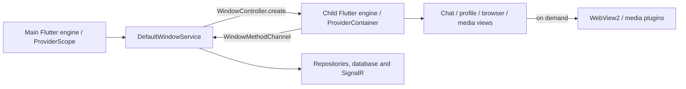

# Windows multi-window audit

Audited 2026-11-03, repository commit 26eb2a1. Flutter 3.47.0 stable, Dart 3.13.0, Windows x64; `desktop_multi_window` 0.3.1, `flutter_inappwebview` 6.2.0-beta.3. Native toolchain/build details require the successful build log.

- `lib/main.dart` routes `multi_window` to `runNativeSubWindowApp`, bypassing `bootstrap`. `lib/core/native_window/native_sub_window_app.dart` creates a separate ProviderContainer, limits its image cache to 15 MiB / 50 entries, and registers the child channel. This shows the bootstrap path is avoided; it does **not** prove that no lazy provider ever initializes network/database state. Further per-window provider tracing is required.
- `windows/runner/flutter_window.cpp` creates the main FlutterViewController and registers a subset of plugins for child controllers, including WebView and media plugins. Plugin registration alone does not establish that a WebView process is created. `windows/runner/main.cpp` contains app-link forwarding, COM and separate UI thread configuration. Do not overwrite this runner for a prototype.
- `lib/core/services/window_service.dart` creates windows through `WindowController.create`, tracks pending creation and keys chats as `chat:<ownerId>:<sessionUnitId>`; repeated open activates and refreshes the existing record. Account-scope changes and concurrent opens still require runtime verification.
- Current exact-ID close hides and releases content, then retains the controller in a bounded cache of six. This intentionally retains an engine; it is not evidence of destruction. Legacy `chat:<sessionId>` close invokes `disposeWindow` instead. Reopen/close races and the safety of destruction must be validated against recent fixes before changing this policy.
- Profile hover uses `showProfileCardAt` and a `tool:profile_card` child; hide invokes `hide_profile`, preserving the engine. Cross-window hover tracking and edge placement depend on Windows native controls. Contacts, session split view and chat page are callers. Existing `DesktopProfileCardDialog` is a modal interaction, not a drop-in replacement for hover.
- Browser and media are separate windows with on-demand contents; `window_release_content` and `browser_clear_tabs` are invoked during close. Actual WebView/decoder process release and cross-engine subscriptions have not been measured.

The plugin's different engines do not establish different OS processes or independent Dart VMs. No conclusion about measured per-window memory or leaks can be drawn from this audit alone. The sampler attributes descendants by observed live parent PID; detached WebView processes, GPU memory and Dart heaps need separate tools and attribution.
